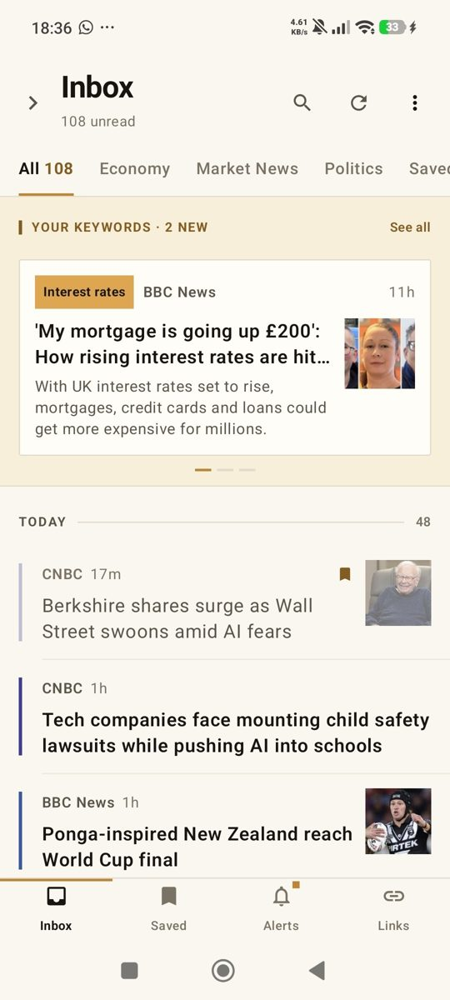
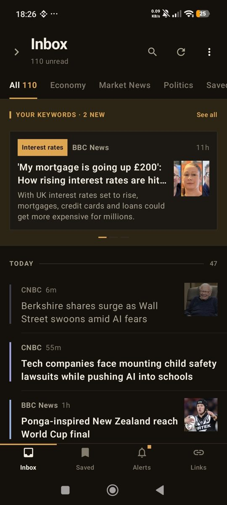
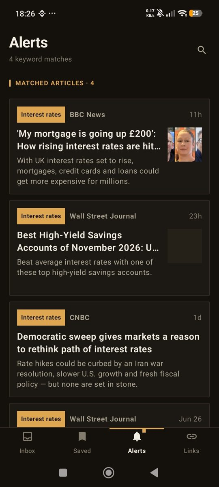
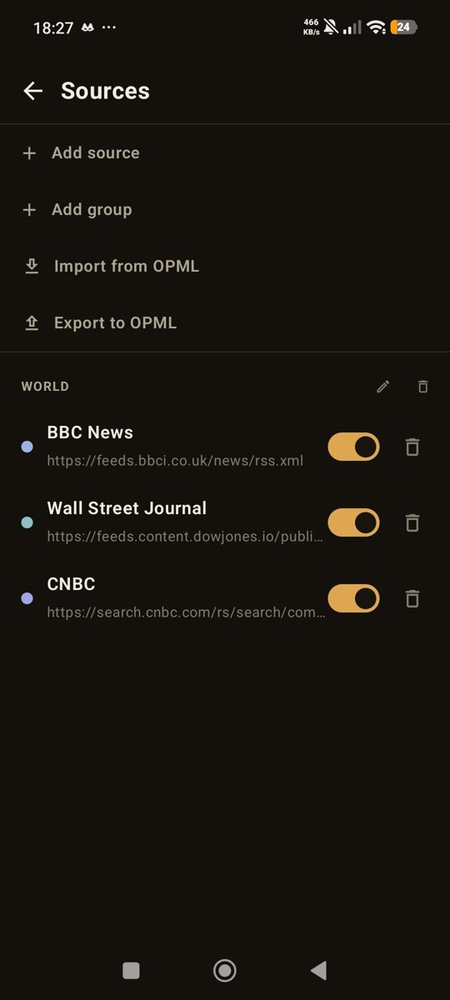

# NewsLab

[](https://github.com/kasun-97/NewsLab/actions/workflows/android.yml)
[](https://github.com/kasun-97/NewsLab/releases/latest)
[](LICENSE)

A priority-inbox RSS reader for Android, written in Kotlin with Jetpack Compose.
Articles that match your keyword rules are pinned to the top of the inbox; everything
else flows into a day-grouped timeline where the same story from several outlets
collapses into one card. Everything stays on the phone: there is no account, no
server and no analytics. The app talks only to the feeds you add, the article pages
you open and the images they reference.

<p align="center">
  
  
  
  
</p>

## Features

**Inbox**

- **Keyword alerts.** A rule fires when *all* of its words appear in an article's title
  or summary, in any order; wrap words in `"quotes"` to require an exact phrase.
  Matching is case-insensitive and substring-based. Matches are pinned under a
  **KEYWORD ALERTS** header for 24 hours and can raise Android notifications.
- **Story clustering.** Near-duplicate headlines across sources (SimHash for syndicated
  copy, IDF-weighted cosine for independent coverage, within a 48-hour window) are shown
  as one card you can swipe between. Done on-device with no dependencies; toggleable.
- **Three list layouts**: timeline rows, photo-forward cards or a dense compact list.
- **Categories** (Economy, Market News, Politics ship as editable defaults) are
  comma-separated match terms. Articles are auto-tagged from their title, summary and
  the publisher's own RSS tags, and categories appear as filter chips. Editing a rule or
  category re-classifies stored articles immediately.
- Per-source colours, a sources drawer (swipe from the left edge), search, unread
  counter, mark-all-read, hide-read-articles option.

**Reader**

- Opens articles in-app. When the feed only carries an excerpt, a lightweight
  readability-style extractor fetches the page and pulls out the main body. It checks
  the site's `robots.txt` first and backs off if the site disallows the crawler.
- Find in article, choice of reading typeface (Literata, Open Sans or the system font)
  and four text sizes.
- Save, share, mark read/unread or delete from a long-press sheet. Sharing produces a
  1080×1080 social card drawn on a canvas, so it looks the same on every device.

**Tabs**: Inbox, Saved (kept forever, never pruned), Alerts (every keyword match) and
an optional Links tab for reference pages that aren't feeds, filed into foldable,
reorderable lists.

**Sources**

- Paste a site URL or a feed URL; auto-discovery finds the feed (direct check, then
  `<link rel="alternate">`, then common paths, validating each candidate by parsing it).
- Group sources into folders. Import and export the whole list as OPML 2.0.
- A source that fails to refresh shows why under its row (HTTP status, timed out, host not
  found, not a feed) until a fetch succeeds again.
- A first-run picker offers a curated list of feeds. No feeds are hard-wired in.

**Background and data**

- WorkManager refreshes every 15 minutes, 30 minutes, 1, 2 or 4 hours on any network and
  posts a high-priority notification for new keyword matches. Fetches are conditional
  (`If-None-Match` / `If-Modified-Since`), so an unchanged feed costs a 304 and no download.
- Unsaved articles are pruned after 14 days, keyword-alert matches after 90 days. Saved
  articles are never pruned.
- Backup to a single SQLite file, or a zip that also carries the cached thumbnails;
  restore either. A full reset returns the app to its fresh-install state.
- Statistics screen: counts, per-source breakdown, refresh history, on-disk footprint.

**Appearance**: light, dark or follow-system; two design languages (Warm Ledger, a
ruled-paper look, and Classic, the original white-and-grey); interface font and size.

## Building

Requirements: JDK 17 and an Android SDK with platform 35 and build-tools 35.0.0.
Android Studio Ladybug or newer bundles both. For command-line builds set `JAVA_HOME`
and `ANDROID_HOME` (or write `sdk.dir=...` into `local.properties`).

```bash
./gradlew :app:assembleDebug        # Linux/macOS
gradlew.bat :app:assembleDebug      # Windows
```

The debug APK lands in `app/build/outputs/apk/debug/app-debug.apk`. The Gradle wrapper
(8.13) downloads itself, and `gradle/gradle-daemon-jvm.properties` pins the daemon to a
JetBrains Runtime 21 that Gradle fetches automatically.

| Toolchain | Version |
|---|---|
| Android Gradle Plugin | 8.13.2 |
| Kotlin / KSP | 2.0.21 |
| Compose BOM | 2024.12.01 |
| Min / target SDK | 26 / 35 |

Signed APKs for each version are on the [Releases](https://github.com/kasun-97/NewsLab/releases)
page. `assembleRelease` is minified with R8; it signs the APK only if an untracked
`keystore.properties` (storeFile, storePassword, keyPassword, keyAlias) is present at the repo
root, and otherwise produces an unsigned APK. A `profiling` build type gives release code
signed with the debug key for on-device performance checks.

The one automated test is an instrumented render of the share card. Run it with a device
attached:

```bash
./gradlew :app:connectedDebugAndroidTest
```

## Notes and known assumptions

- The default categories and the two example keyword rules (IMF, interest rates) use
  terms from economic news; edit or delete them to suit what you read.
- Feed dates that carry no time zone are interpreted as Asia/Colombo, because the feeds
  that omit one are Sri Lankan outlets publishing local wall-clock time. Change the zone
  in `TextUtil.kt` if your zoneless feeds come from elsewhere.
- Requests go out with a `NewsLab/<version>` User-Agent; the robots.txt token is
  `newslab`.
- Android has refused cleartext HTTP since target SDK 28 and the app claims no exemption,
  so `http://` article links are upgraded to `https://` before fetching.
- On Android 13+ the app asks for notification permission on first launch.

## Status

This is a personal project that I use daily. Issues and pull requests are welcome, but
there is no release schedule and no support commitment.

## Licence

Apache License 2.0; see [LICENSE](LICENSE). The bundled fonts (Archivo Narrow, Literata,
Open Sans) are under the SIL Open Font License 1.1; see [NOTICE](NOTICE) and the
`licenses/` directory.
